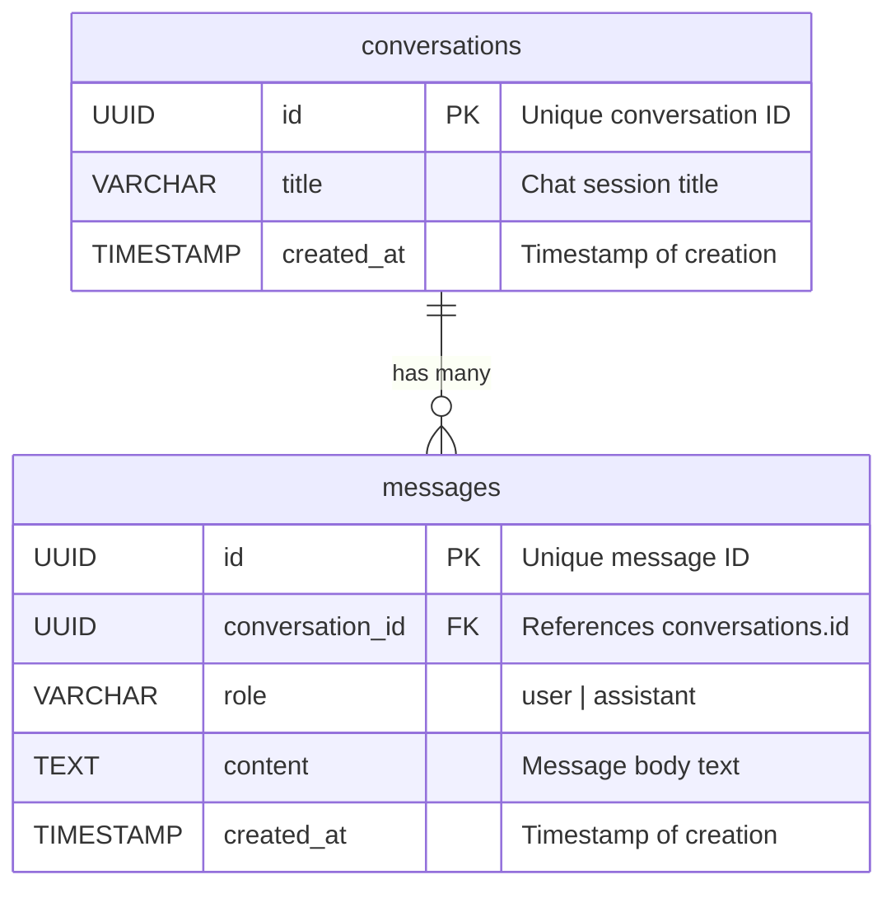

# Database Schema & Entity Relationship Diagram

## ER Diagram

## Data Dictionary

### `conversations`
| Column | Type | Constraints | Description |
| :--- | :--- | :--- | :--- |
| `id` | `UUID` / `INTEGER` | `PRIMARY KEY` | Unique identifier for the chat session |
| `title` | `VARCHAR(255)` | `NOT NULL`, Default: `'New Chat'` | Short title or topic summary |
| `created_at` | `TIMESTAMP WITH TIME ZONE` | `DEFAULT NOW()` | Record creation timestamp |

### `messages`
| Column | Type | Constraints | Description |
| :--- | :--- | :--- | :--- |
| `id` | `UUID` / `INTEGER` | `PRIMARY KEY` | Unique identifier for the message |
| `conversation_id` | `UUID` / `INTEGER` | `FOREIGN KEY (conversations.id) ON DELETE CASCADE` | Conversation thread reference |
| `role` | `VARCHAR(20)` | `NOT NULL`, `CHECK(role IN ('user', 'assistant'))` | Message author role |
| `content` | `TEXT` | `NOT NULL` | The message payload |
| `created_at` | `TIMESTAMP WITH TIME ZONE` | `DEFAULT NOW()` | Timestamp when message was logged |
